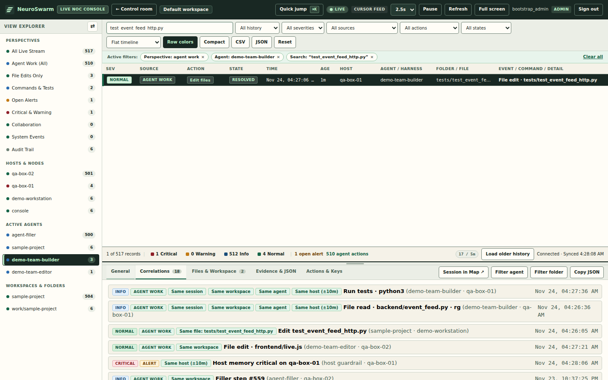

<p align="center"></p>
<h1 align="center">NeuroSwarm</h1>

**NeuroSwarm shows what your coding agents are doing across your machines.** See which agent ran a command, which file it changed and when the machine reported a problem. Host it yourself and choose which project folders to share.



*Example data. Select a file edit and open Correlations to see the reads and commands from the same session.*

## Start locally

From the repository root, with Python 3.12 or later:

```sh
python3 backend/server.py --host 127.0.0.1 --port 8790
```

Open **http://localhost:8790** and select **Create org**. In **Install & enroll**, create an observer token and follow the command for your operating system. An empty organization is expected until an observer reports its first heartbeat. For a remote machine, configure a reachable HTTPS address first.

Prefer containers? Run `docker compose up --build -d` and open the same address. [HTTPS, storage and backup](deploy/self-host.md)

## Read your first session

1. Choose a project folder on the observer. Preview what leaves the machine with `--preview-activity` before enabling collection.
2. Make a small edit with a supported coding agent. Open **Live → Agent Work (All)** and search the filename.
3. Select the row and open **Correlations**. The activity map shows the session, tool and recorded file evidence. Missing assignment links appear as unknown.

| View | What it answers |
| --- | --- |
| Agent work | Who owns each assignment, and what result did they record? |
| Activity map | Which machine, agent and session produced this step? |
| Live events | Which edits, commands and resource alerts occurred together? |
| Incident history | Who acknowledged a recurring alert, and when did the host recover? |

## Data and access

The observer sends host health by default. Session capture is opt-in by folder. Program names are visible when recorded. Sharing redacted command detail requires a separate opt-in. Organizations have separate access controls and data. OpenBot is an optional source of recorded assignments.

[Supported activity sources](docs/capture-coverage.md) · [Capture formats](ACTIVITY-CONTRACT.md) · [Observer installs](REMOTE-CONTRACT.md) · [Task links](LINK-CONTRACT.md) · [Identity and roles](AUTH-CONTRACT.md) · [Browser tests](tests/BROWSER-TESTS.md)

## Trying NeuroSwarm on your machine?

[Share your installation experience](.github/ISSUE_TEMPLATE/self-host.md). Tell us how long it took to find your first confirmed edit, where you got stuck, and whether you would use NeuroSwarm for another session. Use example names for hosts and files.

[Release notes](CHANGELOG.md) · [Report a security concern privately](SECURITY.md)

## License

[PolyForm Noncommercial 1.0.0](LICENSE). Existing installations keep the same service names and configuration variables (for example, `SWARMCONTROL_PORT`).
